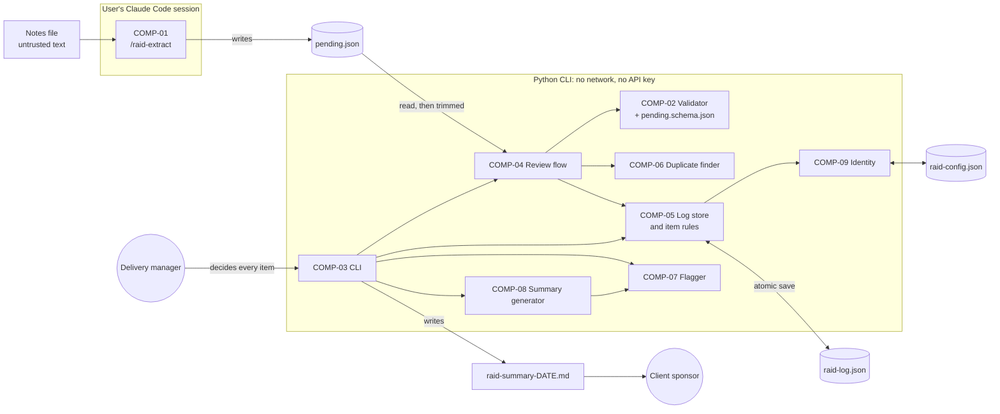

# RAID Log Manager — Architecture (Stage 3, high-level design)

**Status:** DRAFT (awaiting review), revised with decisions DEC-10 to DEC-22 · **Date:** 2026-10-10
**Upstream:** `docs/requirements.md` (42 REQs, 10 NFRs, DEC-01 to DEC-22), `docs/epics.md`, `docs/stories/`
**Decisions:** `docs/adr/ADR-001` to `ADR-006`, all Accepted on 2026-10-10.

## 1. Shape

One person runs a command-line tool in a project folder. There is no server, no database and no network. The only AI step, extraction, happens outside the Python tool, in the user's own Claude Code session, and its output is treated as untrusted until a schema check and a human decision have both passed (ADR-002).

A **project folder** is the directory the commands are run from. It holds everything for one project:

| File | Written by | Purpose |
|---|---|---|
| `pending.json` | `/raid-extract` (COMP-01); trimmed by Review (COMP-04) | Proposals awaiting a decision |
| `raid-log.json` | Log store (COMP-05) only | The log: items, their sources and history |
| `raid-config.json` | Identity (COMP-09) | The user's name (ADR-005) |
| `raid-summary-YYYY-MM-DD.md` | Summary generator (COMP-08) | The weekly summary |

## 2. Components

| ID | Component | Responsibility | Interface | Data owned |
|---|---|---|---|---|
| COMP-01 | `/raid-extract` command | Read one notes file as data and propose RAID items. Lives in `.claude/commands/raid-extract.md`, outside the Python app | In: path to a notes file. Out: a complete `pending.json` matching the contract | None. Never reads or writes the log |
| COMP-02 | Pending contract and validator | Define what a valid `pending.json` is and reject anything else, naming the file, proposal and field | `validate(path)` → proposals, or an error list | `pending.schema.json` (the contract, ADR-004) |
| COMP-03 | CLI | Parse commands, call the components, print results and messages, set exit codes. The only part that talks to the terminal or reads the clock | `raid review, add, list, show, update, close, flag, summary` | None |
| COMP-04 | Review flow | Show each proposal with its excerpt and likely duplicates; take edit, accept, merge or reject; ask for a missing source date; save each decision at once | Driven by the CLI; calls COMP-02, COMP-05, COMP-06 | Removes decided proposals from `pending.json` |
| COMP-05 | Log store and item rules | The only writer of the log. Atomic save, ID allocation, item rules (allowed values, 80-character title, source required), append-only history, nothing ever removed | `load()`, `add_item()`, `update_item()`, `merge_source()`, `get()`, `all()` | `raid-log.json` |
| COMP-06 | Duplicate finder | Given a proposal and the log's items, return likely duplicates by the DEC-01 rule. Pure function, no I/O (ADR-003) | `find(proposal, items)` → item IDs | None |
| COMP-07 | Flagger | Given items and today's date, return unowned, overdue and stale flags. Pure function | `flags(items, today)` | None |
| COMP-08 | Summary generator | Given items and today's date, produce the summary text: five sections, ranking, 5-per-section cap, trimming to 400 words. Pure function; reuses COMP-07's overdue rule | `render(items, today)` → markdown | None (the CLI writes the file) |
| COMP-09 | Identity | Ask for the user's name once and return it for history entries | `current_user()` | `raid-config.json` |

Design rules that hold everywhere:
- Only COMP-05 writes `raid-log.json`, and every write goes through one save routine (ADR-001).
- COMP-06, COMP-07 and COMP-08 are pure functions of their inputs, so they are tested without files or a real clock.
- "Today" enters through the CLI and is passed down, so tests fix the date.
- Text from notes is only ever stored and displayed. No component interprets it.

## 3. Diagram

## 4. Data flow: paste notes → review → log → summary

1. The manager saves call notes as a file and runs `/raid-extract <notes file>` in Claude Code. COMP-01 reads the file as data and writes a complete `pending.json`: one proposal per item with type, title, description, owner, severity, due date, source excerpt and, only if the notes state a full date with a year, the source date.
2. The manager runs `raid review`. COMP-02 validates the whole file first. Any failure stops here with a message; nothing is shown and the log is untouched.
3. For each proposal, COMP-04 shows it with its excerpt and any likely duplicates from COMP-06, Closed items included. The manager may edit fields; an edit that breaks a rule is refused. A changed type or title re-runs the duplicate check.
4. On **accept**, a missing source date is asked for, then COMP-05 allocates the next ID for the type, writes the creation history entry with the user's name from COMP-09, and saves atomically. On **merge**, the proposal's excerpt and date are added to the existing item's sources, the item's title, owner, severity and due date stay as they were, and a history entry records it. If the existing item is Closed, the manager is told before confirming that the merge will reopen it; on confirming, the item returns to Open in the same save, with a second history entry giving the reason "reopened by merge of a new proposal" (DEC-22). On **reject**, nothing is written to the log and the rejection is not recorded.
5. After each decision the proposal is removed from `pending.json` (atomic write), so an interrupted review resumes with only the undecided ones.
6. Day to day, `raid list`, `show`, `update`, `close` and `flag` read and change the log through COMP-05, and `raid add` puts in an item by hand with the source "Added manually" and no duplicate check. Every change adds one history entry. A type cannot be changed; a Closed item can be reopened with a reason.
7. On Friday, `raid summary` loads the log, COMP-08 renders at most 400 words, and the CLI writes `raid-summary-YYYY-MM-DD.md`. The manager sends that file. The log is not changed.

## 5. Shape of the data (HLD level only)

- **Log file:** a schema version, one "next number" counter per type (so IDs are never reused), and the list of items.
- **Item:** ID, type, title, description, owner, severity, due date, status, closed date and reason, decision mark, check note (assumptions), waiting-on (dependencies), a list of **sources** (excerpt + date each), and a **history** list.
- **Sources is a list** so a merge can add a second excerpt. The first source is the item's original one and can never be emptied. This settles stage 1 finding R-07.
- **History entry:** timestamp, user name, what changed (created, field old → new, merged). "Created on" and "last changed" are read from the history, which is what the stale flag and "new this week" use (ADR-006).

## 6. Requirements → components

| Component | Requirements |
|---|---|
| COMP-01 `/raid-extract` | REQ-001, REQ-002, REQ-003, REQ-004, REQ-039, REQ-042 |
| COMP-02 Validator | REQ-005, REQ-006, REQ-041 (in `pending.json`) |
| COMP-03 CLI | REQ-014, REQ-015, REQ-034 (output), REQ-019 (no delete command) |
| COMP-04 Review flow | REQ-007, REQ-008, REQ-009, REQ-024, REQ-040 |
| COMP-05 Log store and item rules | REQ-010, REQ-011, REQ-012, REQ-013, REQ-016, REQ-017, REQ-018, REQ-019, REQ-020, REQ-021, REQ-022, REQ-036, REQ-041 |
| COMP-06 Duplicate finder | REQ-023 |
| COMP-07 Flagger | REQ-025, REQ-026, REQ-027 |
| COMP-08 Summary generator | REQ-028, REQ-029, REQ-030, REQ-031, REQ-032, REQ-033, REQ-037, REQ-038 |
| COMP-09 Identity | REQ-035 |

## 7. NFRs → components

| NFR | Component | Mechanism | How it is verified |
|---|---|---|---|
| NFR-001 Performance | — | None identified (OQ-11). The design loads and rewrites the whole file on each change, which is fine for hundreds of items and would need revisiting for tens of thousands | Not verified |
| NFR-002 Atomic writes | COMP-05 | Write the new content to a temporary file in the same folder, flush it to disk, then replace the log in one operating-system step (ADR-001) | Test injects a failure at each step of the save and checks the log equals the before or the after state |
| NFR-003 Never lose accepted items | COMP-05, COMP-04 | A save guard refuses any save in which an existing item ID is missing. Each accept is saved at once. A log that cannot be read is never overwritten: the command stops with a message | Command-sequence test; interrupted-review test; corrupted-log test |
| NFR-004 No network, no API key | COMP-02 to COMP-09 | Standard library plus one offline validation library (ADR-004). No code path opens a connection or reads a key | Test suite runs with sockets blocked; import check over `src/` |
| NFR-005 Notes are data, not instructions | COMP-01, COMP-02, COMP-04 | Four layers (ADR-002): the command's prompt fences the notes as data; the command's allowed tools are limited to reading the notes and writing `pending.json` (REQ-042); the validator accepts only the contract's fields, allowed values and lengths and rejects control characters; a human sees the excerpt and decides every item. The CLI never executes or interprets proposal text | Trap-fixture run of `/raid-extract` checked by a person; automated check of the command file's allowed tools; validator tests with extra fields, wrong values and control characters |
| NFR-006 Data stays local | COMP-03, COMP-05, COMP-08, COMP-09 | Every file the tool writes is one of the four named files in the project folder (ADR-005) | Test asserts no file outside the project folder is created or changed |
| NFR-007 Append-only history | COMP-05 | The same save guard refuses any save in which an existing history entry is changed or missing (ADR-006). There is no interface that edits history | Test compares history before and after every command; test that a tampering update is refused |
| NFR-008 Under 5 minutes a week | COMP-03 | One command lists a person's items, one command updates an item | Timed walkthrough at stage 6 |
| NFR-009 Summary ≤ 400 words | COMP-08, COMP-05 | Titles are at most 80 characters; the generator caps each section at 5, then drops the lowest-ranked items until the word count fits | Word count on a worst-case 40-item log |
| NFR-010 Python 3.12 or later, pytest, no Claude session | all Python components | Pure functions for the rules; fixtures for `pending.json`; date passed in; a declared minimum version of 3.12 and no language or library feature newer than 3.12 | Tests run on Python 3.13; 3.12 compatibility by inspection; every REQ has a test citing its ID |

## 8. What happens when things go wrong

| Situation | Behaviour |
|---|---|
| `pending.json` is not valid JSON, or was only partly written | COMP-02 reports a parse error; nothing is shown; log untouched |
| One proposal is invalid (missing field, bad type, 81-character title, extra field) | The whole file is rejected with the proposal number and field named |
| A proposal contains instructions copied from the notes | They are stored and shown as text. Nothing acts on them. The manager sees the excerpt and rejects the item |
| The process dies during a save | The log is either the old or the new version; a leftover temporary file is ignored and replaced by the next save |
| The review is interrupted | Items already accepted are in the log; only undecided proposals remain in `pending.json` |
| The process dies after the log is saved but before `pending.json` is trimmed | The proposal is shown again next time, and the duplicate finder shows the item it already became |
| `raid-log.json` is damaged or hand-edited into an invalid state | Every command stops with a message naming the problem; the file is never overwritten |

## 9. Stack

From the brief: command-line tool, Python 3.12 or later, pytest, one JSON file per project, extraction as a Claude Code command. The tool is built and tested on Python 3.13 with code kept compatible with 3.12 (DEC-14). The CLI has eight commands: the brief's `add`, `review`, `list`, `flag`, `summary`, plus `show`, `update` and `close` (DEC-11). Added by this design: the standard library's argument parser, and one third-party library, `jsonschema`, for validating `pending.json` (ADR-004, DEC-12). Code goes in `src/raid/`, tests in `tests/`.

## 10. Points this design depends on

| # | Point | Position | Status |
|---|---|---|---|
| 1 | What happens to `pending.json` after review | Decided proposals are removed; rejections are not recorded | Decided, DEC-10 |
| 2 | Commands beyond the brief's five | `show`, `update`, `close` added | Decided, DEC-11 |
| 3 | Who can use a log | One local user; single writer, no locking; the name file sits in the project folder | Decided, DEC-13 |
| 4 | Type changes and reopening | A type cannot change after acceptance; a Closed item can be reopened with a reason | Decided, DEC-15 |
| 5 | Values on merge | The existing item's values are kept; only the source is added | Decided, DEC-15 |
| 6 | Severity scale | High, Medium, Low, used in the contract and in ranking | Decided, DEC-18 |
| 7 | Supported operating systems | macOS only for v1 | Decided, DEC-16 |
| 8 | Duplicates | Closed items are offered as likely duplicates; `raid add` does not run the check | Decided, DEC-17 |
| 9 | Extraction permissions | The command's allowed tools are limited to reading the notes file and writing `pending.json` | Decided, DEC-19 |

## 11. Known limitations of v1

These are accepted consequences of the decisions above. They go into the release note in stage 6.

| # | Limitation | Why | Source |
|---|---|---|---|
| L-1 | **Rejected proposals are not recorded.** Once a proposal is rejected in review it is gone; there is no trace of what extraction suggested and the manager turned down | Decided proposals are removed from `pending.json` | DEC-10 |
| L-2 | **Single user.** One person uses a project folder. There is no locking: if two people save to the same log, the last save wins and the other change is lost without warning. The project manager has no separate way in | No logins or multi-user in v1 | DEC-13, ADR-001, ADR-005 |
| L-3 | The name in the history is typed once per project and is not verified. The history is protected against the tool's own mistakes, not against someone editing the file by hand | No logins; plain JSON file | ADR-005, ADR-006 |
| L-4 | Duplicates that are worded differently are not detected, two items already in the log cannot be merged, and an item added by hand is not checked for duplicates | Fixed key-word rule; merge exists only in review; `raid add` skips the check | ADR-003, DEC-17 |
| L-5 | Built and tested on Python 3.13. Compatibility with Python 3.12 is by inspection, not by a test run on 3.12 | No Python 3.12 on the build machine | DEC-14 |
| L-6 | Extraction quality and its resistance to instructions hidden in notes are checked by hand, not by automated tests | The CLI never runs extraction | ADR-002 |
| L-7 | **macOS only.** The tool is built and tested on macOS. It is expected to work on Linux and Windows, but that is not tested or supported in v1 | Only the build machine is tested | DEC-16 |
