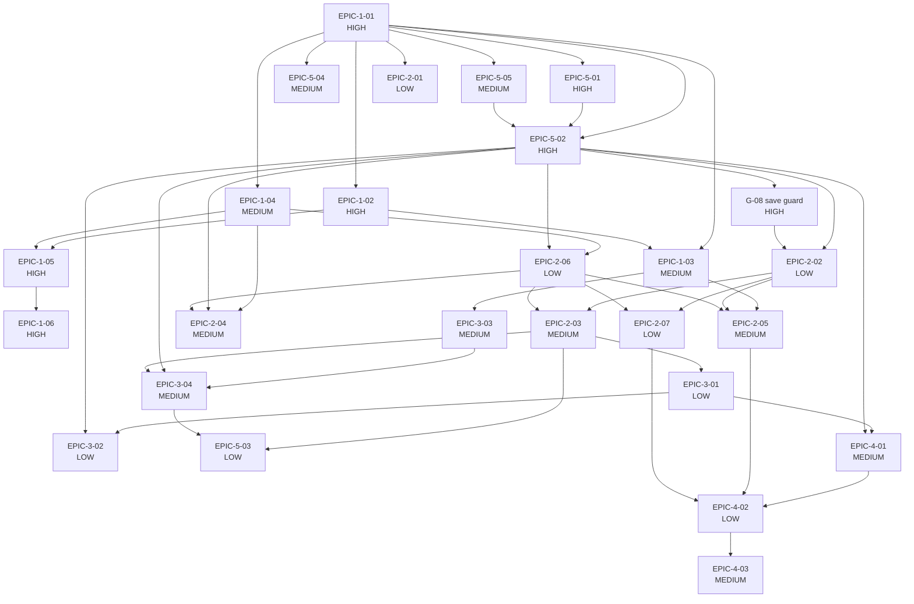

# Task DAG — build order, parallel work, risk tiers (Stage 4)

**Status:** APPROVED (with stage 4, 2026-10-10); amended 2026-10-11 by the owner's decision during stage 5: step 11a added for stage 5 gap G-08 · **Date:** 2026-10-10 · **Upstream:** `docs/specs/`, `docs/epics.md`, `docs/architecture.md`, `docs/reviews/stage-5-review.md` (G-08)

One task per spec. Stage 5 builds one spec at a time, tests first, and commits after each green spec.

## Risk tiers

| Tier | Tests | Before committing | Used for |
|---|---|---|---|
| LOW | Written first, same session as the code | Proceed once tests are green, then commit | Read-only commands and pure functions with no open question |
| MEDIUM | Written first, same session as the code | Show you the diff | New files written, review-flow changes, anything resting on an open question or an assumption to confirm |
| HIGH | **Gate 1:** written first and shown to you; no implementation code until you approve them | **Gate 2:** stop for your approval of the implementation | The save routine and its guard, the first code that writes the log, the `pending.json` contract, the extraction command prompt |

The six HIGH tasks therefore each stop twice: SPEC-EPIC-1-01, SPEC-EPIC-5-01, SPEC-EPIC-5-02, SPEC-EPIC-1-02, SPEC-EPIC-1-05 and SPEC-EPIC-1-06. That is 12 stops for you in stage 5, plus 11 diffs to look at for MEDIUM tasks. Step 11a (G-08, added 2026-10-11) is gated the same way as a HIGH task and adds 2 more stops, 14 in all.

## Build order

| # | Task | Tier | Stops for you | Depends on | Wave | Open questions |
|---|---|---|---|---|---|---|
| 1 | SPEC-EPIC-1-01 Review fixture proposals into the log and list them (thin slice) | HIGH | tests, then code | — | 1 | — |
| 2 | SPEC-EPIC-5-01 Log writes are atomic and never lose accepted items | HIGH | tests, then code | EPIC-1-01 | 2 | — |
| 3 | SPEC-EPIC-5-04 The tool stays local: no network, no API key | MEDIUM | diff | EPIC-1-01 | 2 | — |
| 4 | SPEC-EPIC-5-05 Ask for my name once and remember it | MEDIUM | diff | EPIC-1-01 | 2 | — |
| 5 | SPEC-EPIC-5-02 Every change to an item is recorded in an append-only history | HIGH | tests, then code | EPIC-1-01, EPIC-5-01, EPIC-5-05 | 3 | — |
| 6 | SPEC-EPIC-1-02 Reject invalid extraction output | HIGH | tests, then code | EPIC-1-01 | 2 | — |
| 7 | SPEC-EPIC-1-03 Edit a proposal before accepting it | MEDIUM | diff | EPIC-1-01, EPIC-1-02 | 3 | — |
| 8 | SPEC-EPIC-1-04 Keep the source excerpt and date with every item | MEDIUM | diff | EPIC-1-01 | 2 | — |
| 9 | SPEC-EPIC-1-05 `/raid-extract` writes proposals from a notes file | HIGH | tests, then code | EPIC-1-02, EPIC-1-04 | 3 | — |
| 10 | SPEC-EPIC-1-06 Extraction ignores instructions hidden in notes | HIGH | tests, then code | EPIC-1-05 | 4 | — |
| 11 | SPEC-EPIC-2-06 View one item in full | LOW | none | EPIC-1-04, EPIC-5-02 | 4 | — |
| 11a | G-08 Save guard refuses a field change that has no new history entry (stage 5 gap; extends SPEC-EPIC-5-02, NFR-007, ADR-006) | HIGH | tests, then code | EPIC-5-02 | 4 | — |
| 12 | SPEC-EPIC-2-02 Update an item | LOW | none | EPIC-5-02, G-08 | 5 | — |
| 13 | SPEC-EPIC-2-01 List only my items | LOW | none | EPIC-1-01 | 2 | — |
| 14 | SPEC-EPIC-2-03 Status, and closing an item with a reason | MEDIUM | diff | EPIC-2-02, EPIC-2-06 | 6 | — |
| 15 | SPEC-EPIC-2-05 Check note on assumptions, waiting-on party on dependencies | MEDIUM | diff | EPIC-1-03, EPIC-2-02, EPIC-2-06 | 6 | — |
| 16 | SPEC-EPIC-2-04 Add an item by hand | MEDIUM | diff | EPIC-1-04, EPIC-5-02, EPIC-2-06 | 5 | — |
| 17 | SPEC-EPIC-2-07 Mark an item as needing a decision | LOW | none | EPIC-2-02, EPIC-2-06 | 6 | — |
| 18 | SPEC-EPIC-3-01 Flag unowned and overdue items | LOW | none | EPIC-2-03 | 7 | — |
| 19 | SPEC-EPIC-3-02 Flag stale items | LOW | none | EPIC-3-01, EPIC-5-02 | 8 | — |
| 20 | SPEC-EPIC-3-03 Show likely duplicates during review | MEDIUM | diff | EPIC-1-03 | 4 | — |
| 21 | SPEC-EPIC-3-04 Merge a proposal into an existing item | MEDIUM | diff | EPIC-3-03, EPIC-5-02, EPIC-2-03 | 7 | — |
| 22 | SPEC-EPIC-5-03 Items are never deleted | LOW | none | EPIC-2-03, EPIC-3-04 | 8 | — |
| 23 | SPEC-EPIC-4-01 Generate the weekly summary with new and overdue items | MEDIUM | diff | EPIC-3-01, EPIC-5-02 | 8 | — |
| 24 | SPEC-EPIC-4-02 Summary shows top risks, what is blocked by whom, and decisions needed | LOW | none | EPIC-4-01, EPIC-2-05, EPIC-2-07 | 9 | — |
| 25 | SPEC-EPIC-4-03 Summary shows owners and never exceeds 400 words | MEDIUM | diff | EPIC-4-02 | 10 | — |

## What can run in parallel

A wave is a set of tasks whose dependencies are all in earlier waves, so tasks in the same wave do not depend on each other. Stage 5 still builds one spec at a time in the order above; the waves show where the order is a choice and not a necessity.

| Wave | Tasks |
|---|---|
| 1 | EPIC-1-01 |
| 2 | EPIC-5-01, EPIC-5-04, EPIC-5-05, EPIC-1-02, EPIC-1-04, EPIC-2-01 |
| 3 | EPIC-5-02, EPIC-1-03, EPIC-1-05 |
| 4 | EPIC-1-06, EPIC-2-06, G-08, EPIC-3-03 |
| 5 | EPIC-2-02, EPIC-2-04 |
| 6 | EPIC-2-03, EPIC-2-05, EPIC-2-07 |
| 7 | EPIC-3-01, EPIC-3-04 |
| 8 | EPIC-3-02, EPIC-5-03, EPIC-4-01 |
| 9 | EPIC-4-02 |
| 10 | EPIC-4-03 |

Step 11a (G-08) was added on 2026-10-11. Because SPEC-EPIC-2-02 now waits for it, SPEC-EPIC-2-02 and everything that depends on it moved one wave later. The build order of the 25 specs is unchanged.

Tasks in the same wave that touch the same file should still not be built at the same time: `review.py` (EPIC-1-02, 1-03, 1-04, 3-03, 3-04, 2-05), `store.py` (EPIC-5-01, 5-02, 1-04, 2-03) and `summary.py` (EPIC-4-01, 4-02, 4-03).

## Counts

- Tasks: 25 specs (HIGH 6, MEDIUM 11, LOW 8) plus 1 gated step for stage 5 gap G-08 (HIGH), 26 in all.
- Cycles: none. Every task depends only on tasks earlier in the order.
- LOW tier tasks with an open question: none.

## Diagram

